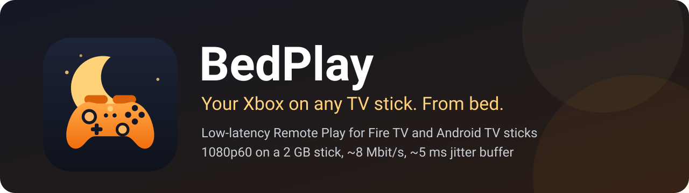
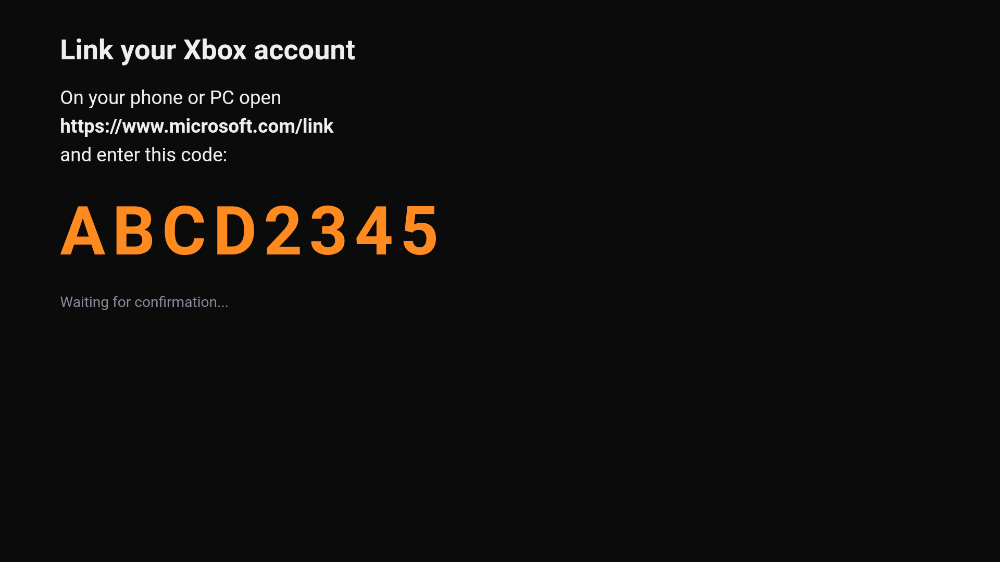
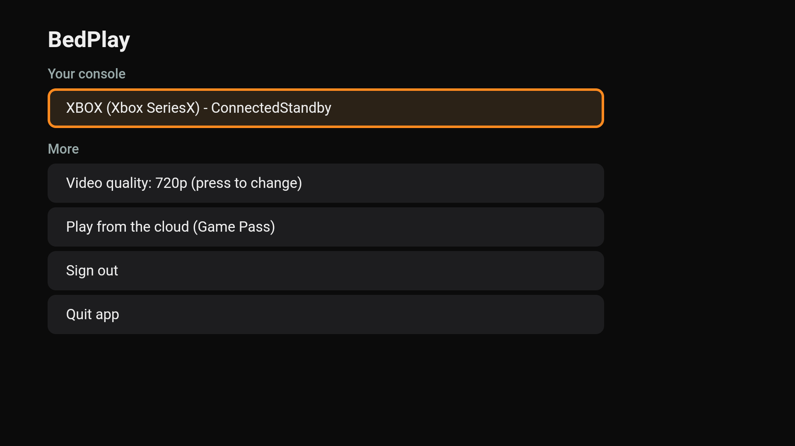
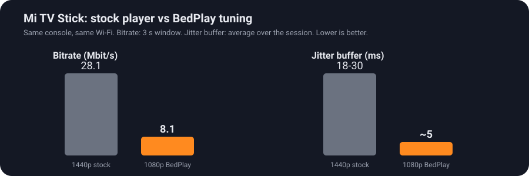

<p align="center">
  
</p>

<p align="center">
  <a href="README.md"></a>
  <a href="LICENSE"></a>
  
</p>

**BedPlay** manda sullo schermo di una chiavetta TV economica i giochi che girano sulla **tua Xbox**, così puoi giocare dal letto, dal divano o da un'altra stanza. È una piccola app Android nativa pensata per hardware modesto: interfaccia leggera, stream WebRTC e bitrate/risoluzione regolati perché una chiavetta da 2 GB regga 1080p a 60 fps.

> **Progetto non ufficiale.** BedPlay non è creato, approvato né sostenuto da Microsoft. Leggi l'[avviso](#avviso) prima di usarlo.

## Perché esiste

L'app Xbox ufficiale per TV funziona solo su pochi modelli Fire TV, e non ho trovato nessuna app ufficiale per le chiavette Android TV / Google TV. Il browser non è una via d'uscita: nei nostri test quello del Fire TV non passava il controller alle pagine web e non riusciva ad avviare lo stream.

BedPlay parla con lo stesso servizio di streaming Xbox dei client ufficiali, direttamente sulla chiavetta, e aggiunge quello che a queste chiavette serve: **poter controllare quanto è pesante lo stream**.

## In breve

- **Remote Play dalla tua Xbox** (Series X|S / One) su chiavette Fire TV e Android TV, provato su una Mi TV Stick e su una Fire TV Stick 4K di prima generazione.
- **1080p a 60 fps con circa 8 Mbit/s**, invece dei 1440p a circa 28 Mbit/s che la console sceglie di default.
- **Buffer di jitter minimo** (circa 5 ms) e RTT di 7-18 ms sul Wi-Fi a 5 GHz in casa.
- **Controller:** i gamepad Bluetooth vengono mappati sul layout standard e inviati alla console.
- **Statistiche a schermo** a richiesta (LB + RB + Y): risoluzione, fps, pacchetti persi, jitter, tempo di decodifica.
- **Menu qualità video** (1080p / 720p / 540p, che impostano il limite di bitrate).
- **Privacy:** i token restano nell'archivio privato dell'app; l'app parla solo con i server Microsoft e con la tua console. Niente statistiche, niente pubblicità, nessun nostro server.
- Interfaccia in italiano e inglese (segue la lingua del dispositivo).

## Dispositivi provati

| Dispositivo | Sistema | Risultato |
|---|---|---|
| Xiaomi Mi TV Stick (MiTV-AYFR0, 2 GB di RAM) | Android 11 | Funziona, 1080p60 |
| Amazon Fire TV Stick 4K (1ª gen, 2018) | Fire OS 6 (Android 7.1.2) | Funziona, 1080p60 |

Console usata: Xbox Series X. Hai provato un'altra chiavetta o console? Apri una segnalazione con l'output di `tools/measure.py` e la aggiungiamo qui.

## Schermate

<p align="center">
  
  
</p>

(Le schermate sono in inglese; l'app segue la lingua del dispositivo.)

## Benchmark

Misurati il 20/11/2026 con una Xbox Series X, entrambe le chiavette sul Wi-Fi a 5 GHz, console nella stessa stanza. I numeri vengono dai contatori `getStats()` di WebRTC dello stream in corso, gli stessi che legge [`tools/measure.py`](tools/measure.py).

<p align="center">
  
</p>

| | Mi TV Stick, player di serie | Mi TV Stick, BedPlay | Fire TV Stick 4K (2018), BedPlay |
|---|---|---|---|
| Video | 2560x1440 | 1920x1080 | 1920x1080 |
| Frame al secondo | 52-58 | 59-60 | 59-61 |
| Bitrate | 28,1 Mbit/s | 8,1 Mbit/s | 7,7 Mbit/s |
| Buffer di jitter (media sessione) | 18-30 ms | ~5 ms | ~4,8 ms |
| Round trip chiavetta-console | 36-61 ms | 8-10 ms | 7-18 ms |
| Tempo di decodifica per frame (media) | 71 ms | non misurato | 35 ms |
| Frame scartati dal decoder | 165 su 7.206 (2,3%) | 31 su 889 nei primi ~15 s | 63 su 11.687 (0,5%) in ~3 min |
| Pacchetti persi | 488 in ~2 min | 0 in ~15 s | 0 in ~3 min |
| Blocchi del video | 5 in ~2 min | 0 in ~15 s | 4 in ~3 min |

Come leggere i dati con onestà:

- **Migliorato di sicuro:** bitrate (-71%), carico di decodifica, buffer di jitter e pacchetti persi. A sensazione, sulla Mi TV Stick lo stream è passato da lento a fluido.
- **Cosa la tabella non dice:** le sessioni hanno durate diverse, quindi i contatori cumulativi (frame scartati, blocchi, pacchetti persi) sono solo indicativi. Nelle finestre di misura da 3 s non sono comparsi nuovi scarti né blocchi, ma non abbiamo ancora fatto test lunghi.
- **Non misurato:** la latenza completa (dal pulsante allo schermo), il tempo di codifica della console e il ritardo del tuo schermo. I numeri sopra riguardano solo rete e decoder.
- Una misura per configurazione, una casa, una console. I tuoi risultati saranno diversi: lancia `tools/measure.py` e mandaci i tuoi.

Metodo e valori grezzi: [docs/benchmarks.md](docs/benchmarks.md) (in inglese).

## Avvio rapido

### 1. Prepara la Xbox

Sulla console: **Impostazioni > Dispositivi e connessioni > Funzioni remote** e attiva *Abilita funzioni remote*. Accedi con lo stesso account Microsoft che userai in BedPlay e imposta la console come Xbox principale. Per svegliarla dallo standby usa **Impostazioni > Generali > Modalità di alimentazione e avvio > Sospensione** (non *Risparmio energia*). Altro in [docs/troubleshooting.md](docs/troubleshooting.md).

### 2. Installa l'app

Scarica `bedplay-<versione>.apk` dalla pagina [Releases](../../releases) e installala a mano.

- **Fire TV:** Impostazioni > My Fire TV > Opzioni sviluppatore > *App da fonti sconosciute* (e *Debug ADB* se usi adb), poi installa con l'app *Downloader* oppure:
  ```
  adb connect <ip-chiavetta>:5555
  adb install bedplay-<versione>.apk
  ```
- **Android TV / Google TV:** attiva le opzioni sviluppatore, poi `adb install` come sopra o un'app per file.

L'APK è firmato in modalità debug. Per compilarne e firmarne uno tuo vedi [Compilare](#compilare).

### 3. Accedi

Apri BedPlay. Mostra un codice: dal telefono o dal PC vai su <https://www.microsoft.com/link>, inserisci il codice e accedi. La tua password non viene mai scritta nell'app.

### 4. Collega un controller e gioca

Collega un gamepad Bluetooth dalle impostazioni della chiavetta, apri BedPlay, scegli la console e gioca.

| Azione | Comando |
|---|---|
| Mostra / nascondi le statistiche | LB + RB + Y |
| Esci dallo stream | **Indietro** sul telecomando, due volte |
| Cambia qualità | Menu > *Qualità video* (vale dallo stream successivo) |

## Regolazioni

Di default BedPlay chiede uno stream che una chiavetta riesce a decodificare: limita il bitrate video (8 Mbit/s all'impostazione di default) e dice alla console di non usare la "risoluzione personalizzata". Preset nel menu:

| Preset | Limite bitrate | Note |
|---|---|---|
| 1080p | 15 Mbit/s | Immagine più pulita, più carico di decodifica |
| **720p (default)** | **8 Mbit/s** | La console manda comunque 1080p, con meno bit per frame |
| 540p (leggera) | 5 Mbit/s | Per Wi-Fi debole |

La risoluzione finale la decide la console: nei nostri test non è mai scesa sotto 1080p, quindi i preset cambiano soprattutto il bitrate. Vedi [docs/how-it-works.md](docs/how-it-works.md).

## Compilare

Servono JDK 17, Android SDK 34 e, solo per ricompilare il player, Node.js 18+.

```
# facoltativo: ricompila il player WebRTC (è già incluso)
cd web
npm install
npm run build

# compila l'APK
cd ../android
./gradlew assembleDebug        # Windows: gradlew.bat assembleDebug
# risultato: app/build/outputs/apk/debug/app-debug.apk
```

Se Gradle non trova l'SDK, crea `android/local.properties` con `sdk.dir=<percorso dell'SDK Android>`.

## Limiti noti

- Funzionano solo le console Xbox raggiungibili dal servizio Microsoft (Series X|S, One). Niente PlayStation.
- Niente chat vocale né microfono, e per ora niente vibrazione del controller.
- La modalità cloud (Xbox Cloud Gaming con Game Pass) è nel menu ma è **sperimentale e non ancora provata** per intero.
- Il risveglio della console dallo standby è implementato ma non ancora provato.
- Provato solo con NAT aperto, in rete di casa.
- La risoluzione la sceglie la console; l'app può solo limitare il bitrate.
- Microsoft può cambiare o bloccare il servizio in qualsiasi momento, e l'app smetterebbe di funzionare.

## Avviso

BedPlay è un progetto indipendente della comunità. **Non è affiliato a Microsoft, né da lei autorizzato, mantenuto, sponsorizzato o approvato.** *Xbox*, *Xbox Series X|S*, *Game Pass* e i relativi nomi e loghi sono marchi di Microsoft Corporation e qui servono solo a indicare con quale prodotto funziona il software.

L'app usa interfacce di streaming di Microsoft **non documentate pubblicamente** e accede con l'identificativo OAuth pubblico dell'app Xbox di Microsoft, perché per questo servizio non esiste un client pubblico. Usare client non ufficiali può essere contrario ai termini di servizio di Microsoft. Il progetto è pensato per uso personale con la tua console e il tuo account ed è fornito **così com'è, senza alcuna garanzia**: lo usi a tuo rischio. Non usarlo per accedere a giochi o servizi che non possiedi. Non si può promettere che non venga bloccato.

## Sicurezza e privacy

- L'accesso usa il flusso a codice di Microsoft: l'app non vede mai la tua password.
- I token di aggiornamento restano nell'archivio privato dell'app (`allowBackup` è disattivato). **Esci dall'account** li cancella.
- Il server interno ascolta solo su `127.0.0.1` e richiede una chiave casuale generata a ogni avvio, così le altre app della chiavetta non possono usarlo per agire sul tuo account.
- L'app contatta solo i servizi di accesso e streaming di Microsoft e la tua console. Nessuna telemetria.
- L'app è in modalità debug (DevTools di Chrome via adb) per poter misurare gli stream. Per una build più sicura rimuovi `setWebContentsDebuggingEnabled(true)` in `MainActivity`.

## Crediti

- [xbox-xcloud-player](https://github.com/unknownskl/xbox-xcloud-player) di Jim Kroon (UnknownSKL), MIT: il player WebRTC su cui si basa il progetto. BedPlay lo include con una piccola modifica ([web/build.js](web/build.js)); vedi [NOTICE](NOTICE).
- Il protocollo di streaming Xbox è stato documentato dalla comunità, in particolare dagli autori di Greenlight e Better xCloud.

## Contribuire

Segnalazioni e pull request sono benvenute, soprattutto: risultati con altre chiavette e console, traduzioni, prove del risveglio dallo standby e una build di rilascio più sicura. Vedi [CONTRIBUTING.md](CONTRIBUTING.md).

## Licenza

[MIT](LICENSE), (c) BedPlay contributors. Avvisi di terze parti in [NOTICE](NOTICE).
