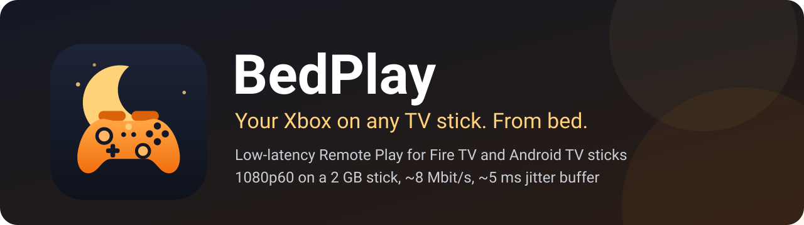
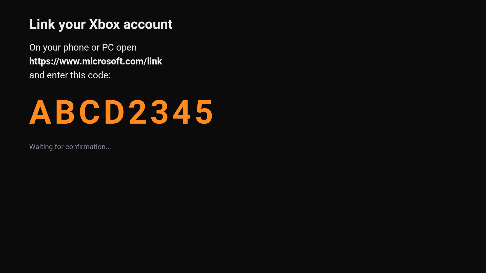
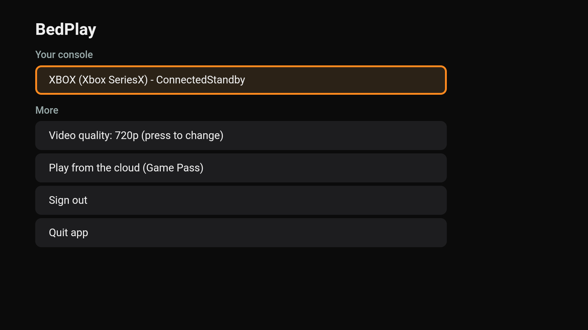
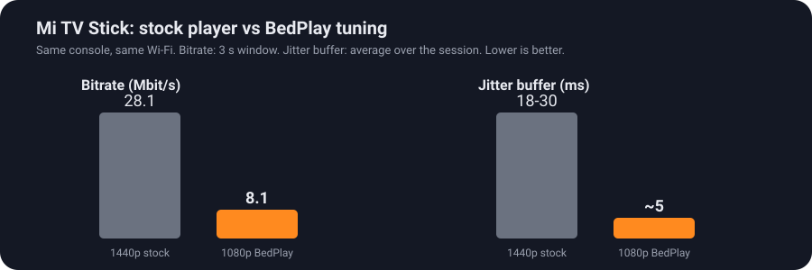

<p align="center">
  
</p>

<p align="center">
  <a href="LICENSE"></a>
  
  
  <a href="README.it.md"></a>
</p>

**BedPlay** streams the games running on **your own Xbox** to a cheap TV stick, so you can play from the bed, the sofa or another room. It is a small, native Android app built for low-end hardware: no heavy UI, a WebRTC stream decoded by the WebView (normally the stick's hardware H.264 decoder), and a bitrate/resolution setup tuned so a 2 GB stick can hold 1080p at 60 fps.

> **Unofficial project.** BedPlay is not made by, affiliated with or endorsed by Microsoft. Please read the [disclaimer](#disclaimer) before using it.

## Why it exists

Microsoft's own Xbox app for TVs only supports a short list of Fire TV models, and I found no official app for Android TV / Google TV sticks. A browser is no way out either: in our tests the Fire TV browser did not expose the gamepad to web pages and did not manage to start a stream.

BedPlay talks to the same Xbox streaming service the official clients use, on the stick itself, and adds the one thing those sticks need: **control over how heavy the stream is**.

## Highlights

- **Remote Play from your Xbox** (Series X|S / One) to Fire TV and Android TV sticks, tested on a Mi TV Stick and a 1st-gen Fire TV Stick 4K.
- **1080p at 60 fps with about 8 Mbit/s**, instead of the 1440p at about 28 Mbit/s the console picks by default.
- **Tiny jitter buffer** (about 5 ms) and an RTT of 7-18 ms on a 5 GHz Wi-Fi in the same house.
- **Gamepad support:** Bluetooth gamepads are mapped to the standard layout and sent to the console.
- **Stats overlay** on demand (LB + RB + Y): resolution, fps, packet loss, jitter, decode time, decoder in use.
- **Video quality menu** (1080p / 720p / 540p presets that set the bitrate cap).
- **Private by design:** your tokens stay in the app's private storage; the app only talks to Microsoft's servers and your console. No analytics, no ads, no server of ours.
- English and Italian interface (follows the device language).

## Tested devices

| Device | OS | Result |
|---|---|---|
| Xiaomi Mi TV Stick (MiTV-AYFR0, 2 GB RAM) | Android 11 | Works, 1080p60 |
| Amazon Fire TV Stick 4K (1st gen, 2018) | Fire OS 6 (Android 7.1.2) | Works, 1080p60 |

Console used: Xbox Series X. Have you tried another stick or console? Please open an issue with your `tools/measure.py` output and we will add it here.

## Screenshots

<p align="center">
  
  
</p>

## Benchmarks

Measured on 2026-11-20 with an Xbox Series X, both sticks on 5 GHz Wi-Fi and the console in the same room. Numbers come from the WebRTC `getStats()` counters of the running stream, the same ones [`tools/measure.py`](tools/measure.py) reads.

<p align="center">
  
</p>

| | Mi TV Stick, stock player | Mi TV Stick, BedPlay | Fire TV Stick 4K (2018), BedPlay |
|---|---|---|---|
| Video | 2560x1440 | 1920x1080 | 1920x1080 |
| Frame rate | 52-58 fps | 59-60 fps | 59-61 fps |
| Bitrate | 28.1 Mbit/s | 8.1 Mbit/s | 7.7 Mbit/s |
| Jitter buffer (session average) | 18-30 ms | ~5 ms | ~4.8 ms |
| Round trip stick-console | 36-61 ms | 8-10 ms | 7-18 ms |
| Decode time per frame (average) | 71 ms | not measured | 35 ms |
| Frames dropped by the decoder | 165 of 7,206 (2.3%) | 31 of 889 in the first ~15 s | 63 of 11,687 (0.5%) in ~3 min |
| Packets lost | 488 in ~2 min | 0 in ~15 s | 0 in ~3 min |
| Video freezes | 5 in ~2 min | 0 in ~15 s | 4 in ~3 min |

How to read this honestly:

- **What improved for sure:** bitrate (-71%), decode load, jitter buffer and packet loss. Subjectively the stream went from laggy to smooth on the Mi TV Stick.
- **What the table cannot say:** the sessions have different lengths, so the cumulative counters (dropped frames, freezes, lost packets) are only indicative. No new drops or freezes appeared during the 3 s measuring windows, but we have not run long-session tests yet.
- **Not measured:** end-to-end (button to photon) latency, console encode time and your display's own delay. The numbers above are the network and decoder side only.
- One run per configuration, one home, one console. Your results will differ; run `tools/measure.py` and send yours.

Full method and raw values: [docs/benchmarks.md](docs/benchmarks.md).

## Quick start

### 1. Prepare the Xbox

On the console: **Settings > Devices & connections > Remote features** and turn on *Enable remote features*. Sign in with the Microsoft account you will use in BedPlay, and make the console your home Xbox. To wake it from standby, set **Settings > General > Power mode & startup > Sleep** (not *Energy saving*). More in [docs/troubleshooting.md](docs/troubleshooting.md).

### 2. Install the app

Download `bedplay-<version>.apk` from the [Releases](../../releases) page and sideload it.

- **Fire TV:** Settings > My Fire TV > Developer options > *Apps from Unknown Sources* (and *ADB debugging* if you use adb), then install with the *Downloader* app or:
  ```
  adb connect <stick-ip>:5555
  adb install bedplay-<version>.apk
  ```
- **Android TV / Google TV:** enable developer options, then `adb install` as above, or use any file manager app.

The APK is debug-signed. See [Building](#building) to build and sign your own.

### 3. Sign in

Open BedPlay. It shows a code: on your phone or PC go to <https://www.microsoft.com/link>, enter the code and sign in. Your password is never typed into the app.

### 4. Pair a gamepad and play

Pair a Bluetooth gamepad in the stick's settings, open BedPlay, choose your console and play.

| Action | Control |
|---|---|
| Show / hide stats | LB + RB + Y |
| Quit the stream | Press **Back** on the remote twice |
| Change quality | Menu > *Video quality* (applies to the next stream) |

## Tuning

By default BedPlay asks for a stream that a stick can decode: it caps the video bitrate (8 Mbit/s at the default setting) and tells the console not to use "custom resolution". Presets in the menu:

| Preset | Bitrate cap | Notes |
|---|---|---|
| 1080p | 15 Mbit/s | Cleaner image, more decode load |
| **720p (default)** | **8 Mbit/s** | The console still sends 1080p, with fewer bits per frame |
| 540p (light) | 5 Mbit/s | For weak Wi-Fi |

The console decides the final resolution: in our tests it never went below 1080p, so the presets mainly change the bitrate. See [docs/how-it-works.md](docs/how-it-works.md).

## Building

Requirements: JDK 17, Android SDK 34, and Node.js 18+ only if you want to rebuild the player bundle.

```
# optional: rebuild the WebRTC player (it is already committed)
cd web
npm install
npm run build

# build the APK
cd ../android
./gradlew assembleDebug        # Windows: gradlew.bat assembleDebug
# output: app/build/outputs/apk/debug/app-debug.apk
```

Create `android/local.properties` with `sdk.dir=<path to your Android SDK>` if Gradle cannot find it.

## How it works (short)

```
 Xbox console  <--- Microsoft streaming service --->  BedPlay on the stick
                                                       |  Android app (Java): gamepad + local server on 127.0.0.1
                                                       |  WebView: player page (xbox-xcloud-player, WebRTC)
                                                       +-- H.264 video decoded on the stick by the WebView
```

Details, including the API calls and what we changed in the player, in [docs/how-it-works.md](docs/how-it-works.md).

## Known limitations

- Only Xbox consoles that Microsoft's streaming service can reach (Series X|S, One) are supported. No PlayStation.
- No voice chat or microphone, and no controller rumble yet.
- The cloud mode (Xbox Cloud Gaming with Game Pass) exists in the menu but is **experimental and untested** end to end.
- Waking a console from standby is implemented but not tested yet.
- Tested only with an open NAT type on a home LAN.
- The console picks the resolution; the app can only cap the bitrate.
- Microsoft can change or block the service at any time and this app would stop working.

## Disclaimer

BedPlay is an independent, community project. It is **not affiliated with, authorized by, maintained by, sponsored by or endorsed by Microsoft**. *Xbox*, *Xbox Series X|S*, *Game Pass* and related names and logos are trademarks of Microsoft Corporation and are used here only to say which product this software works with.

The app uses Microsoft's streaming interfaces, which are **not publicly documented**, and signs in with the public OAuth client ID of Microsoft's own Xbox app, because no public client exists for this service. Using unofficial clients may go against Microsoft's terms of service. This project is meant for personal use with your own console and your own account, and is provided **as is, without any warranty**: use it at your own risk. Do not use it to access games or services you do not own. No promise can be made that it will not be blocked.

## Security and privacy

- Sign-in uses Microsoft's device-code flow; the app never sees your password.
- Refresh tokens are kept in the app's private storage (`allowBackup` is off). **Sign out** removes them.
- The in-app server listens on `127.0.0.1` only, and requires a random key generated at every launch, so other apps on the stick cannot use it to act on your account.
- The only servers the app contacts are Microsoft's login and streaming services and your own console. There is no telemetry.
- The app is debuggable (Chrome DevTools over adb) so that streams can be measured. Remove `setWebContentsDebuggingEnabled(true)` in `MainActivity` for a hardened build.

Report problems privately through GitHub's *Security > Report a vulnerability* if enabled, otherwise open an issue without including tokens.

## Credits

- [xbox-xcloud-player](https://github.com/unknownskl/xbox-xcloud-player) by Jim Kroon (UnknownSKL), MIT: the WebRTC player this project builds on. BedPlay bundles it with a small patch ([web/build.js](web/build.js)); see [NOTICE](NOTICE).
- The Xbox streaming protocol was documented by the community, notably the authors of Greenlight and Better xCloud.

## Contributing

Issues and pull requests are welcome, especially: results from other sticks and consoles, translations, standby wake-up tests and a hardened release build. See [CONTRIBUTING.md](CONTRIBUTING.md).

## License

[MIT](LICENSE), (c) BedPlay contributors. Third-party notices in [NOTICE](NOTICE).
